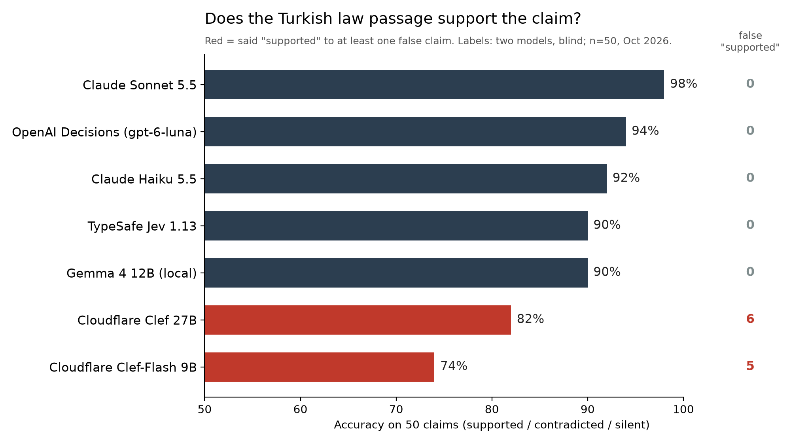

# Turkish legal claim bench

Does an official Turkish legislation passage **support**, **contradict**, or **stay silent on** a claim? 50 claims, 9 official passages, 7 models. A small pilot, not a leaderboard.

## Why

I run a health information site with Turkish rights and regulation articles. A primary-text audit of 6 published legal articles found errors in 5 (one relied on a regulation that had been repealed months earlier). The question here: could a model have caught them?

The most dangerous error is saying **"supported"** to a false claim, because that is the error that slips through a publishing gate silently. So the table reports it separately from accuracy.

## Results (n=50, October 2026)

| Model | Accuracy | False "supported" | Median latency |
|---|---|---|---|
| Claude Sonnet 5.5 | 98% | 0 | batch |
| OpenAI Decisions, `gpt-6-luna` (beta) | 94% (EN instructions: 92%) | 0 | 175 ms |
| Claude Haiku 5.5 | 92% | 0 | batch |
| TypeSafe Jev 1.13 | 90% (EN: 92%) | 0 | 340 ms |
| Gemma 4 12B, Q4_K_M, local (Ollama, thinking off) | 90% | 0 | 3 s |
| Gemma 4 12B, thinking on | 88% (all 44 answered correct; 6 never finished thinking) | 0 | 27 s |
| Cloudflare Clef 27B | 82% (EN: 88%) | 6 | 370 ms |
| Cloudflare Clef-Flash 9B | 74% (EN: 76%) | 5 (EN: 7) | 520 ms |

Notes:
- Clef's false "supported" answers mostly came with low confidence. A rule of "ask a human when confidence < 0.5" cuts them from 6 to 1.
- Most errors sit on the line between "contradicts" and "silent": models confuse a law forbidding something with a law not mentioning it.
- Passages and claims are Turkish. "EN" rows use English instructions over the same Turkish text.

## The ÖTV story

4760 ÖTV Law art. 7(2) ends its last sub-paragraph with "on yılda bir defaya mahsus olmak üzere ilk iktisabı" ("first acquisition, once every ten years"). The AI agent that audits my site read it as belonging only to that last sub-paragraph (scrapped-vehicle replacement) and "corrected" a true sentence on the site. The second annotator read it as the shared closing of all sub-paragraphs. The Revenue Administration's 2025 guide settles it: the exemption is usable once every ten years. The site was re-corrected. Among the tested models, Jev and Clef read it correctly; Claude and Gemma did not.

A verbatim-quote gate proves the quote is in the law. It does not prove the reading is right.

## Labels: read this before trusting the numbers

- Labels were produced by **two models, blind to each other**: annotator A = Claude Opus 5.5, annotator B = OpenAI Codex. Agreement 47/50. Disagreements were adjudicated against the official text and, for one item, the Revenue Administration (GİB) 2025 guide.
- Annotator A is a Claude model. That may favour Claude models in this table.
- **No lawyer has reviewed the labels yet.** If you work with Turkish law and find a wrong label, please open an issue.
- One domain only (disability and health rights). n=50 is small; one item is 2 points.
- Claude models saw all 50 items in one batch (`bench/llm_input.md`); the others were called one item at a time.

## Files

- `bench/evidence.json`: 9 official passages (mevzuat.gov.tr PDFs; law, regulation, SUT), with source and read date.
- `bench/items.jsonl`: 50 claims. `label` (final), `label_annotator_a`, `origin` (`eski_hata` = an error that was actually published, `duzeltme` = its correction, `eski_metin` = old text, `ek` = extra, `tuzak` = deliberate distractor, `eski_dogru` = old text that turned out correct), `note`, `adjudication`.
- `bench/labels_annotator_b.json`: annotator B's blind labels.
- `bench/run.py <model>`: runner (Jev, Clef, Clef-Flash, OpenAI Decisions, Gemma via Ollama). Keys from env: `TYPESAFE_KEY`, `CF_ACCOUNT_ID` + `CF_API_TOKEN`, `OPENAI_API_KEY`. `INSTR_LANG=en` for English instructions.
- `bench/score.py`: accuracy, macro F1, false "supported", published errors caught, median latency.
- `runs/`: raw per-item outputs, including probabilities and confidence where the API returns them.

Reproduce the table: `python3 bench/score.py`

## License

Code: MIT. Claims, labels and runs: CC BY 4.0. Turkish legislation texts are not subject to copyright (5846 FSEK art. 31).

İlkay Demiralay · [ilk.ai](https://ilk.ai)
